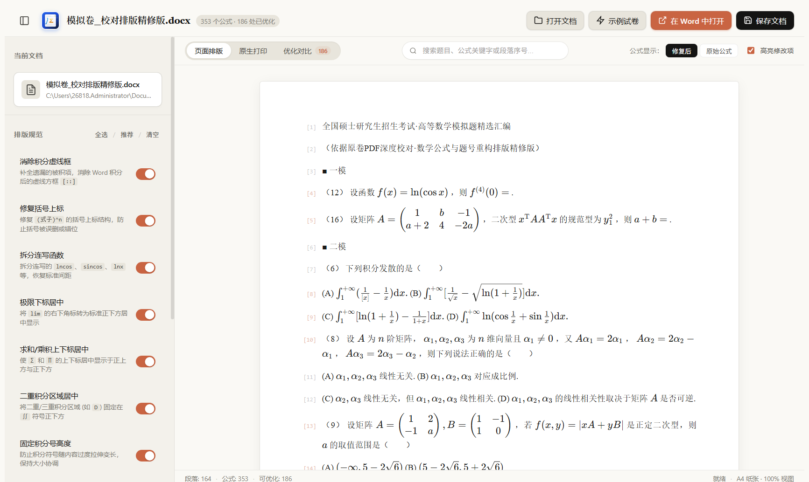

# Word 公式修复工具 (Word Math OMML Repairer)

[](LICENSE)
[](#)
[](https://www.electronjs.org/)
[](https://www.python.org/)

一款面向 Microsoft Word (.docx) 的数学公式（OMML）排版检测与批量规范化修复桌面工具。



---

### 项目背景

在使用 MinerU、Mathpix 或各类 OCR 工具将论文、试卷、讲义转换为 Word 文档时，生成的 Office 数学标记语言（OMML）往往存在多种排版瑕疵，例如积分符号后遗留虚线占位框 `[::]`、括号上标错位、函数连写无间距、求和上下标未居中等。

本工具提供直观的可视化界面，自动扫描文档中的所有数学公式，支持针对性开启修复规则，提供修复前后的实时效果对照，并可一键批量规范化导出。

---

### 主要功能

1. **消除积分虚线框**：自动补全遗漏的被积项，消除 Word 积分符号后的 `[::]` 虚线占位方框；
2. **极限与求和上下标居中**：将 $\lim$、$\sum$、$\prod$ 的上下标置于正下方或正上方，按需构建结构，避免产生多余空占位框；
3. **二重积分区域居中**：将二重/三重积分区域标识（如 $D$）规范固定在 $\iint$ 符号正下方；
4. **固定积分号高度**：控制积分符号随内容过度拉伸拉长的问题，保持大小协调；
5. **修复括号上标结构**：采用括号嵌套平衡回溯算法，精准修复 $(式子)^n$ 结构，防止括号被误删或内部截断；
6. **拆分连写函数**：识别并拆分连写的 `lncos`、`sincos`、`lnx` 等函数，恢复标准数学间距；
7. **正斜体规范化**：
   - 纯数字、微分符号 $\mathrm{d}$、自然常数 $\mathrm{e}$、矩阵转置 $\mathrm{T}$ 规范为正体；
   - 数学变量保持斜体；
   - 公式中的中文字符保持正体整词，避免被拆散或误设为斜体；
8. **集合大括号修复**：规范化集合大括号的定界符属性，支持随内容高度自适应；
9. **字体统一（可选）**：支持将公式中的西文字符与数字一键规范化为标准的 Times New Roman；
10. **多维预览与对比**：
    - **页面排版**：模拟 A4 纸张页面排版，直观高亮展示被优化的公式；
    - **优化对比**：提供修改前/修改后的公式并排对照卡片，可按规则筛选；
    - **原生打印**：支持调用系统已安装的 Microsoft Word 引擎生成高保真预览，或一键在 Word 中全屏查看。

---

### 技术架构

- **桌面端交互层**：Electron + 原生 HTML5 / CSS3（支持侧边栏折叠、浮窗智能防溢出与实时搜索）；
- **公式预览渲染**：KaTeX 引擎渲染实时数学公式；
- **排版解析引擎**：Python + OpenXML DOM 操作（直接解析与安全回写 `.docx` 中的 `word/document.xml`）。

---

### 快速上手

#### 环境要求
- **Node.js**：18.0 或更高版本
- **Python**：3.8 或更高版本（需具备基础标准库；如需导出高保真 PDF 预览，建议已安装 Microsoft Word）

#### 安装与启动

1. **克隆本仓库**
   ```bash
   git clone https://github.com/LOUIS798000/word-math-repair.git
   cd word-math-repair
   ```

2. **安装前端依赖**
   ```bash
   npm install
   ```

3. **启动应用**
   - **方式一（命令行）**：
     ```bash
     npm start
     ```
   - **方式二（Windows 快捷方式）**：
     直接双击根目录下的 `启动Word公式修复工具.bat` 或 `启动Word公式修复工具(零黑框).vbs` 即可拉起应用。

---

### 使用说明

1. 打开软件后，点击右上角**“打开文档”**或直接拖入需要处理的 `.docx` 文件；
2. 左侧侧边栏可按需勾选或关闭具体的排版规则（默认推荐全开）；
3. 在顶部切换**“页面排版”**或**“优化对比”**查看调整细节；
4. 确认效果后，点击右上角**“保存文档”**即可导出已修复的 Word 文档（亦可勾选同时导出 PDF）。

---

### 自动化测试

项目内附带核心排版规则与边界条件的回归测试套件：
```bash
python -m unittest tests/test_bug_fixes.py
```

---

### 开源协议

本项目采用 [MIT 许可证](LICENSE) 开源。欢迎提交 Issue 或 Pull Request 完善排版规则与功能。
